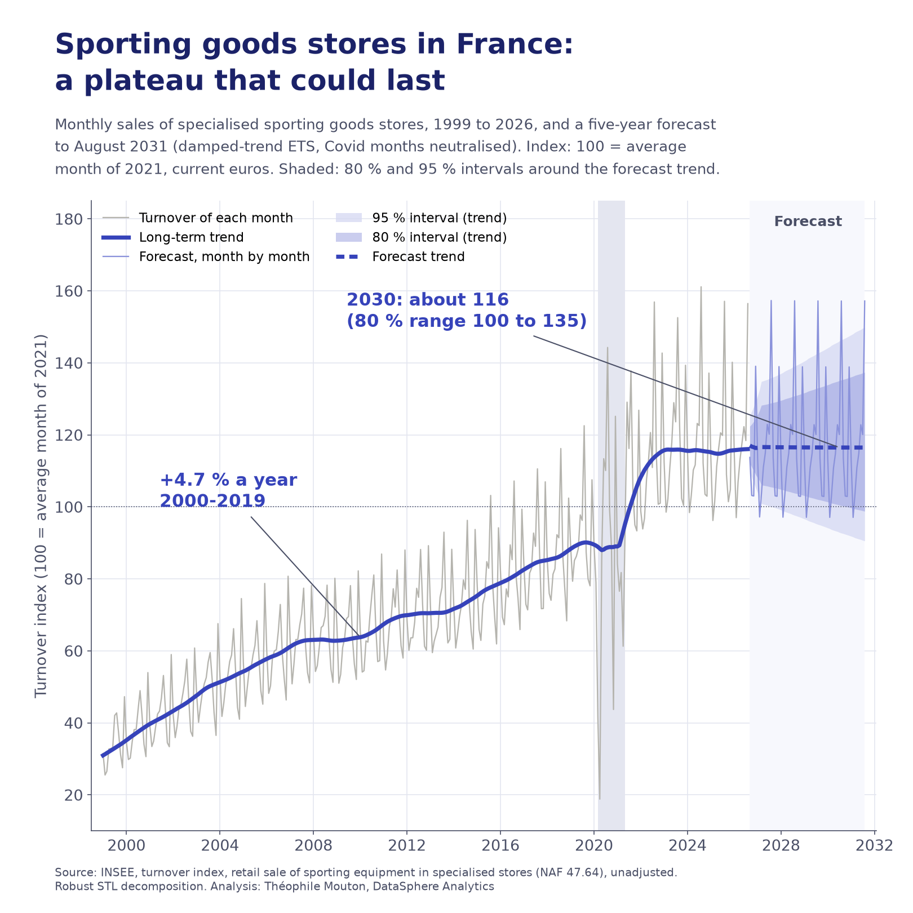

# Sporting goods retail in France: 27 years of monthly demand

A time series analysis of the INSEE monthly turnover index for retail sale of sporting equipment in specialised stores (NAF 47.64), January 1999 to August 2026, with a five-year outlook to 2031.

**[View the report](https://theophilemt92.github.io/sport-retail-forecasting/)**



## What it covers

- **Stationarity:** ADF and KPSS tests on levels and differences
- **Decomposition:** robust STL (trend, seasonality, remainder)
- **Anomaly detection:** robust z-scores (median and MAD) on the STL remainder
- **Drift:** change points in trend growth (PELT) and shifts in the seasonal profile across three periods (1999-2009, 2010-2019, 2022-2026)
- **Forecast benchmarking:** rolling-origin backtest at 12 months of seasonal naive, ETS, ARIMA and Theta (`statsforecast`) and the Chronos-2 time series foundation model (zero-shot), with and without Covid neutralisation, checking both accuracy (MAPE, bias) and interval calibration
- **Five-year outlook:** damped-trend ETS on the Covid-neutralised series, with 80 % and 95 % prediction intervals

## Main results

- Trend growth fell from 4.7 % a year (2000-2019) to 0.8 % a year (2022-2025), in current euros.
- The seasonal profile has drifted: August grew from +25 % to +36 % above trend and now beats Christmas, December shrank from +33 % to +20 %, and the November dip halved (-21 % to -11 %), consistent with Black Friday.
- Neutralising the Covid period cuts the ETS 12-month error from 7.9 % to 3.0 %.
- At this aggregate level, the seasonal naive benchmark (2.4 % MAPE) is hard to beat at 12 months.
- Chronos-2, used zero-shot, reaches 3.4 % MAPE, stays robust on uncleaned Covid data (3.6 % versus 7.9 % for ETS) and gives the best-calibrated 80 % intervals (81 % coverage).
- If the current regime holds, the index stays around 116 in 2030 (2021 = 100), with an 80 % range of 100 to 135. This is a trend extrapolation without covariates: a scenario, not a prediction of the drivers.

## Repository contents

```
.
├── report.qmd                   # Quarto source (Python)
├── index.html                   # rendered report (served by GitHub Pages)
├── figures/linkedin_outlook.png # five-year outlook figure, exported at render time
├── data/insee_ica_4764.csv      # INSEE series 010770520 (raw) and 010770580 (adjusted)
├── data/chronos_*.csv           # precomputed Chronos-2 forecasts
├── scripts/fetch_insee.py       # refreshes the data from the INSEE SDMX API
├── scripts/chronos_backtest.py  # Chronos-2 zero-shot backtest (CPU)
├── requirements.txt
├── requirements-chronos.txt     # separate environment for PyTorch and Chronos
└── template/                    # "Cobalt" report theme (CSS, header, footer)
```

## Reproducing it

Requires [Quarto](https://quarto.org) and Python 3.10+.

```bash
python -m venv .venv
source .venv/bin/activate
pip install -r requirements.txt
python scripts/fetch_insee.py    # optional: refresh the data
QUARTO_PYTHON=.venv/bin/python quarto render report.qmd
```

To recompute the Chronos-2 forecasts (optional, the results are cached in `data/`):

```bash
python -m venv .venv-chronos
.venv-chronos/bin/pip install -r requirements-chronos.txt
.venv-chronos/bin/python scripts/chronos_backtest.py
```

## Data

INSEE, *Indice de chiffre d'affaires - Commerce de détail d'articles de sport en magasin spécialisé* (NAF rév. 2, 47.64), base 2021 = 100. Public data, [INSEE BDM](https://www.insee.fr/fr/statistiques/serie/010770520).

---

Théophile L. Mouton · [DataSphere Analytics](https://theophile-mouton.com)
